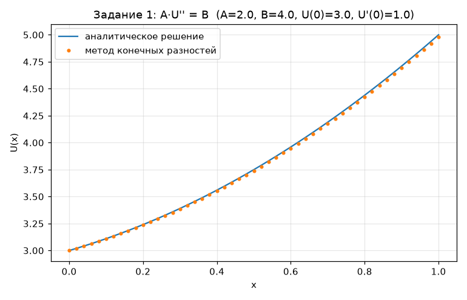
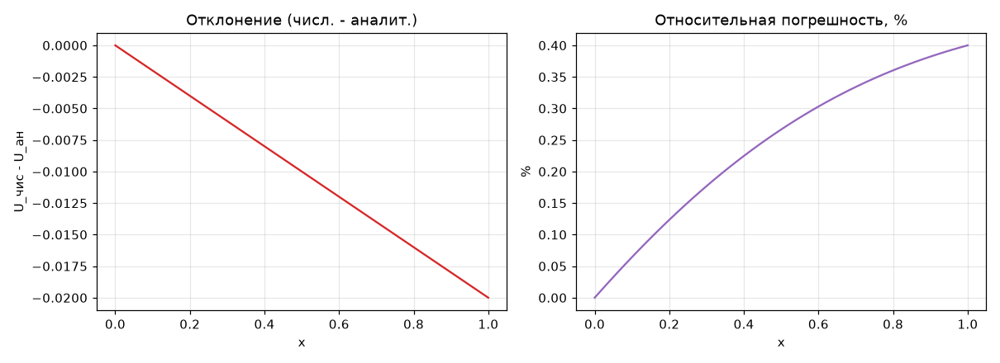
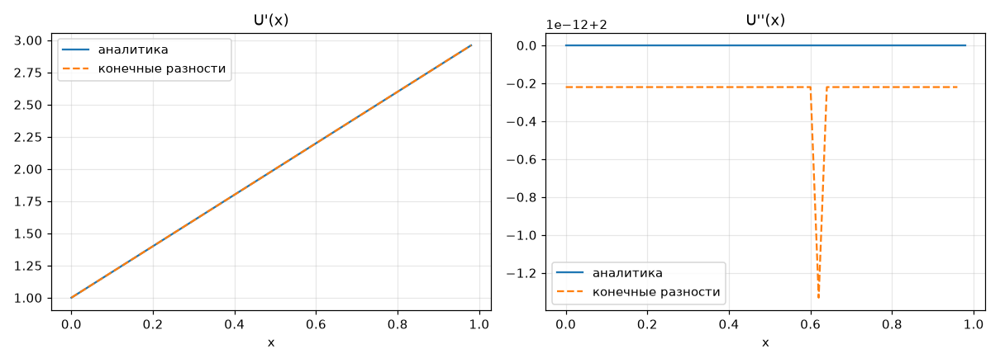
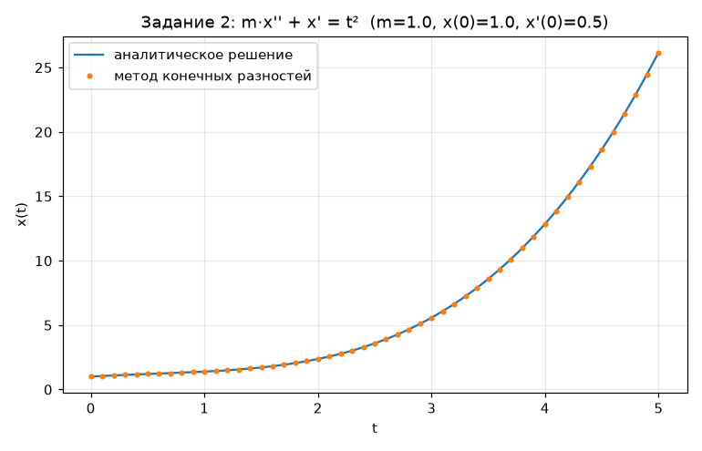
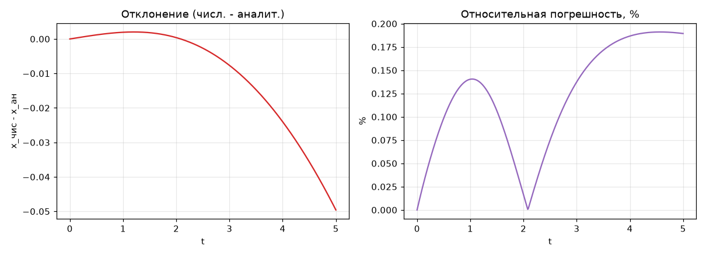
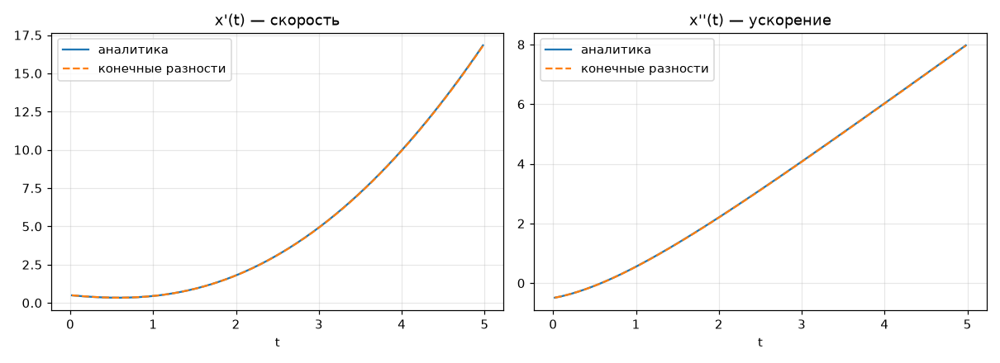
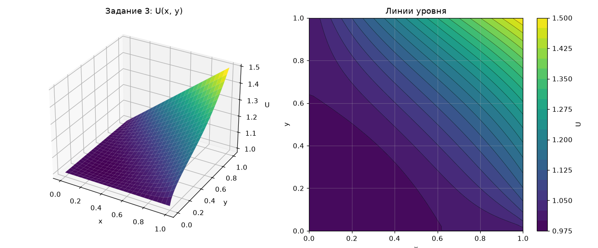

# Лабораторная работа №1. Метод конечных разностей

## Цель работы

Научиться решать дифференциальные уравнения на компьютере методом конечных разностей и сравнить то что получилось с точным решением. Решали три задачи: равноускоренное движение, движение с трением и уравнение Пуассона на квадрате.

## Идея метода

Почти все законы физики записываются через производные. Например второй закон Ньютона: ускорение это вторая производная координаты по времени, и оно равно силе делённой на массу. Компьютер производные брать не умеет, он умеет только складывать и умножать числа. Поэтому делаем так.

Берём отрезок времени и режем его на маленькие кусочки шириной h. Получаются точки x₀, x₁, x₂ и так далее. Значения функции в этих точках обозначаем U[0], U[1], U[2]…

Производная это то, насколько быстро меняется величина. Если у нас есть координата тела в два соседних момента, то скорость примерно равна разнице координат делённой на время между ними. Это как определять скорость машины по двум фотографиям, сделанным с интервалом в секунду. Получаются формулы:

```
U'  ≈ (U[i+1] − U[i]) / h
U'' ≈ (U[i+1] − 2·U[i] + U[i−1]) / h²
```

Вторая формула это «изменение скорости»: разница между скоростью на следующем шаге и на предыдущем, ещё раз делённая на h.

Подставляем эти разности в уравнение и получаем обычную формулу, по которой по двум предыдущим точкам считается следующая. Чтобы начать, нужны две первые точки, их дают начальные условия: начальное положение и начальная скорость. Первая точка U[0] это просто начальное положение, а вторая U[1] = U[0] + h·U'(0), то есть тело сделало один маленький шаг со своей начальной скоростью.

Чем меньше шаг h, тем точнее получается, но тем больше нужно считать.

Проверяли точность так: если есть точное решение, смотрим на сколько численное от него отличается — в абсолютных числах и в процентах. Если точного решения нет, подставляем найденные числа обратно в уравнение и смотрим насколько оно выполняется, и ещё смотрим что при уменьшении шага ответ перестаёт меняться.

---

## Задание 1. Равноускоренное движение

Уравнение `A·U'' = B`, начальные условия U(0) = C, U'(0) = D.

Взяли A = 2, B = 4, C = 3, D = 1, отрезок от 0 до 1, 50 шагов, h = 0,02.

### Физический смысл

Это просто второй закон Ньютона `m·a = F`. A это масса, B это сила, U это координата, а x играет роль времени. Сила постоянная, значит ускорение тоже постоянное: a = B/A = 2. Если ускорение постоянное то скорость растёт равномерно, по прямой, а координата растёт по параболе. Так движется например камень, падающий без сопротивления воздуха, или машина которую разгоняют с постоянной силой.

### Как решали

Подставили разность вместо второй производной и выразили следующую точку:

```
U[i+1] = 2·U[i] − U[i−1] + h²·B/A
```

Старт: U[0] = 3, U[1] = 3 + h·1. Дальше просто идём по шагам. В программе это функция march1: создаётся массив, в него записываются две первые точки, потом цикл считает все остальные.

Точное решение находится просто: два раза интегрируем U'' = 2 и получаем

```
U(x) = x² + x + 3
```

Здесь 3 это начальное положение, x это вклад начальной скорости, а x² это вклад ускорения — ровно школьная формула s = s₀ + v₀t + at²/2.

### Результаты



*Рисунок 1 — точное и численное решение задания 1*

Точки численного решения лежат прямо на линии точного решения, на глаз разницы почти нет. Но она есть:



*Рисунок 2 — отклонение и относительная погрешность в задании 1*

Отклонение растёт вдоль x и в конце доходит до 0,02. В процентах это не больше 0,4%.

Ещё по полученным точкам посчитали скорость и ускорение:



*Рисунок 3 — скорость и ускорение в задании 1*

Скорость растёт по прямой — тело всё время разгоняется. Ускорение получилось ровно 2, горизонтальная линия, то есть оно постоянное как и должно быть при постоянной силе.

Проверили что будет если менять шаг:

| число шагов n | максимальная ошибка |
|---|---|
| 25 | 0,04 |
| 50 | 0,02 |
| 100 | 0,01 |
| 200 | 0,005 |

Шагов в два раза больше — ошибка в два раза меньше. Значит у метода первый порядок точности.

Откуда ошибка: вторую точку мы посчитали как будто на первом шаге тело ехало с постоянной скоростью D. А на самом деле оно уже разгонялось, и мы потеряли кусочек пути h²·B/2A. Эта маленькая ошибка в самом начале потом тянется за решением и накапливается, к x = 1 она становится 0,02. Если добавить этот кусочек в U[1], то для этой задачи схема станет вообще точной.

**Вывод:** численное решение совпадает с точным, ошибка маленькая и уменьшается при уменьшении шага. Физически это обычное равноускоренное движение.

---

## Задание 2. Движение с трением

Уравнение `m·x'' + x' = t²`, x(0) = 1, x'(0) = 0,5. Взяли m = 1, время от 0 до 5, 500 шагов, h = 0,01.

### Физический смысл

Это опять второй закон Ньютона, только сил две:

- `t²` — внешняя сила, которая со временем растёт, тело тянут всё сильнее и сильнее;
- `x'` — сила вязкого трения. Она пропорциональна скорости и направлена против движения. Так работает сопротивление воды или воздуха при небольших скоростях: чем быстрее едешь тем сильнее тебя тормозит.

Интересно что ровно такое же уравнение получается для броуновской частицы во второй лабе, только там вместо t² стоит случайная сила от ударов молекул.

### Как решали

Заменили обе производные разностями и выразили следующую точку:

```
x[i+1] = ( t_i² + x[i]·(2m/h² + 1/h) − m·x[i−1]/h² ) / ( m/h² + 1/h )
```

Старт: x[0] = 1, x[1] = 1 + h·0,5. В программе это функция march2.

Точное решение: уравнение линейное, поэтому решение складывается из двух частей. Первая часть C₁ + C₂·e^(−t/m) — это то что было бы без внешней силы. Экспонента быстро затухает: трение «съедает» начальную скорость тела. Величина m это время за которое это происходит, тело как бы забывает с какой скоростью оно стартовало. Вторая часть t³/3 − m·t² + 2m²·t — это движение которое навязывает внешняя сила. Подобрали её как многочлен. Константы нашли из начальных условий, для m = 1:

```
x(t) = −0,5 + 1,5·e^(−t) + t³/3 − t² + 2t
```

### Результаты



*Рисунок 4 — точное и численное решение задания 2*

Тело уезжает всё дальше и всё быстрее, график загибается вверх. В конце x(5) получилось 26,127, а точно 26,177.



*Рисунок 5 — отклонение и относительная погрешность в задании 2*

Отклонение медленно копится и доходит до 0,05, но в процентах это меньше 0,19%, потому что само решение растёт ещё быстрее.



*Рисунок 6 — скорость и ускорение в задании 2*

Вот тут самое интересное с точки зрения физики. В начале скорость немного падает: с 0,5 до примерно 0,36. Это потому что внешняя сила t² в начале почти ноль, а трение уже есть, и оно тормозит тело. Ускорение в начале отрицательное, −0,5. Примерно при t = 0,6 сила становится больше трения, ускорение становится положительным, и дальше тело разгоняется. Потом скорость растёт почти по параболе, а ускорение почти по прямой. Трение растёт вместе со скоростью, но догнать силу t² не может, поэтому тело всё время ускоряется.

Зависимость ошибки от шага:

| число шагов n | максимальная ошибка |
|---|---|
| 125 | 0,199 |
| 250 | 0,099 |
| 500 | 0,050 |
| 1000 | 0,025 |
| 2000 | 0,012 |

Опять шаг меньше в два раза — ошибка меньше в два раза, первый порядок. Тут причина в том что первую производную мы заменили простой разностью «вперёд», она грубее чем формула для второй производной.

**Вывод:** тело сначала чуть тормозится трением, а потом разгоняется всё сильнее, потому что сила растёт быстрее чем трение. Численное решение хорошо совпадает с точным.

---

## Задание 3. Уравнение Пуассона на квадрате

Нужно найти функцию U(x, y) на квадрате со стороной 1:

```
U_xx + U_yy = 1
```

Условия на краях:

- на нижней и левой стороне U = 1;
- на правой и верхней стороне задана производная по x: U_x = 0,5.

Сетка 51 на 51 точку, h = 0,02.

### Физический смысл

Такое уравнение описывает поле которое уже не меняется со временем. Например температура в тонкой пластине, когда всё уже прогрелось и установилось. Или электрический потенциал, когда в области равномерно размазан заряд.

Что вообще значит U_xx + U_yy? Если посмотреть на разностную формулу ниже, то это получается насколько значение в точке отличается от среднего по четырём соседям. Если бы справа стоял 0, то каждая точка была бы ровно средним своих соседей — так ведёт себя температура в пластине без источников тепла, всё плавно. У нас справа 1, это значит каждая точка чуть ниже среднего соседей. Для температуры это как будто пластину везде равномерно охлаждают, тепло по всей площади уходит. Поэтому внутри квадрата значения получились даже немного меньше чем на краях, минимум 0,9849 при том что на краях 1.

Края: на левой и нижней стороне значение зафиксировано, как будто край прижат к чему-то с постоянной температурой. На правой и верхней задана производная, то есть как быстро меняется температура возле края, а это по сути поток тепла через край.

### Как решали

Тут уже нельзя идти шаг за шагом как раньше. Значение в каждой точке зависит от четырёх соседей, а они от своих, всё связано. Поэтому для каждой внутренней точки пишем уравнение «крестом»:

```
( U[i+1,j] + U[i−1,j] + U[i,j+1] + U[i,j−1] − 4·U[i,j] ) / h² = 1
```

Для точек на краях свои уравнения: на левой и нижней U = 1, на правой U[n,j] − U[n−1,j] = 0,5·h, на верхней так же по x. Так как в левом верхнем углу U = 1, то по верхней стороне получается U(x, 1) = 1 + 0,5·x, и в правом верхнем углу U = 1,5.

Всего получилось 2601 уравнение с 2601 неизвестным. Решали их все сразу как систему. В программе это функция solve_poisson: она нумерует все точки одним номером, заполняет матрицу коэффициентов и решает систему через spsolve из библиотеки SciPy. Матрица почти вся из нулей, ведь в каждом уравнении участвуют только 5 соседних точек, поэтому используется специальный разреженный формат, иначе было бы очень медленно.

### Результаты



*Рисунок 7 — поверхность U(x, y) и линии уровня*

Поле растёт от левого нижнего угла, где U = 1, к правому верхнему, где U = 1,5. Это понятно: на правой и верхней стороне задана положительная производная, значит в ту сторону значения растут.

| величина | значение |
|---|---|
| наименьшее и наибольшее U | 0,9849 и 1,5000 |
| U в центре квадрата | 1,0486 |
| насколько нарушается уравнение, максимум | 8,8·10⁻¹² |
| производная на правом краю | 0,5000 |

Точного решения тут нет, поэтому проверяли по-другому. Подставили найденные числа обратно в уравнение — оно выполняется с точностью 10⁻¹², то есть система решена правильно. Производная на правом краю получилась ровно 0,5 как и задано.

И ещё посчитали на разных сетках значение в центре:

| n | U в центре |
|---|---|
| 10 | 1,05214 |
| 20 | 1,04982 |
| 40 | 1,04881 |
| 80 | 1,04834 |
| 160 | 1,04812 |

При уменьшении шага значение почти перестаёт меняться, разница между соседними строчками каждый раз падает примерно в два раза. Значит решение сходится, и порядок опять первый, из-за простых разностей на краях.

**Вывод:** нашли установившееся поле на квадрате, оно удовлетворяет уравнению и всем условиям на краях. Внутри оно чуть ниже чем на краях, потому что правая часть уравнения работает как равномерный сток.

---

## Как устроена программа

Всё в одном файле lab1.py. Запуск командой `python3 lab1.py`. Нужны библиотеки NumPy для расчётов, SciPy для решения системы уравнений и Matplotlib для графиков.

Для каждого задания своя функция: task1, task2, task3. Каждая сама считает, рисует графики в папку plots и печатает числа. Ещё есть вспомогательные функции чтобы не повторять код: save сохраняет график, error_plots рисует ошибку, derivative_plots рисует производные. Из-за этого графики в первых двух заданиях выглядят одинаково и их удобно сравнивать.

---

## Общий вывод

Все три задачи решили методом конечных разностей, то есть заменили производные разностями значений в соседних точках.

1. Равноускоренное движение: численное решение совпало с точным x² + x + 3, ошибка 0,02. Постоянная сила даёт постоянное ускорение, скорость растёт линейно.
2. Движение с трением: тело сначала немного тормозится, а потом разгоняется всё сильнее, потому что сила растёт как t² и трение за ней не успевает. Ошибка меньше 0,2%.
3. Уравнение Пуассона: нашли установившееся поле на квадрате, уравнение выполняется с точностью 10⁻¹², при уменьшении шага ответ сходится.

Во всех задачах ошибка уменьшается пропорционально шагу. Чтобы считать точнее, надо уменьшать шаг или аккуратнее записывать начальные и граничные условия.

---

## Код программы

Файл `lab1.py`:

```python
import os

import matplotlib
matplotlib.use("Agg")
import matplotlib.pyplot as plt
import numpy as np
from scipy.sparse import lil_matrix
from scipy.sparse.linalg import spsolve

OUT = os.path.join(os.path.dirname(os.path.abspath(__file__)), "plots")
os.makedirs(OUT, exist_ok=True)

plt.rcParams.update({"figure.dpi": 110, "axes.grid": True, "grid.alpha": 0.3})


def save(fig, name):
    fig.tight_layout()
    fig.savefig(os.path.join(OUT, name))
    plt.close(fig)


def error_plots(x, num, ref, name, xlabel, ylabel):
    dev = num - ref
    rel = np.abs(dev) / np.abs(ref) * 100
    fig, ax = plt.subplots(1, 2, figsize=(11, 4))
    ax[0].plot(x, dev, color="tab:red")
    ax[0].set(title="Отклонение (числ. - аналит.)", xlabel=xlabel, ylabel=ylabel)
    ax[1].plot(x, rel, color="tab:purple")
    ax[1].set(title="Относительная погрешность, %", xlabel=xlabel, ylabel="%")
    save(fig, name)
    return dev, rel


def derivative_plots(x, d1_num, d2_num, d1_an, d2_an, name, xlabel, l1, l2):
    fig, ax = plt.subplots(1, 2, figsize=(11, 4))
    ax[0].plot(x, d1_an, label="аналитика")
    ax[0].plot(x, d1_num, "--", label="конечные разности")
    ax[0].set(title=l1, xlabel=xlabel)
    ax[0].legend()
    ax[1].plot(x, d2_an, label="аналитика")
    ax[1].plot(x, d2_num, "--", label="конечные разности")
    ax[1].set(title=l2, xlabel=xlabel)
    ax[1].legend()
    save(fig, name)


def march1(A, B, C, D, L, n):
    h = L / n
    U = np.zeros(n + 1)
    U[0] = C
    U[1] = C + h * D
    for i in range(1, n):
        U[i + 1] = 2 * U[i] - U[i - 1] + h**2 * B / A
    return np.linspace(0, L, n + 1), U


def task1(A=2.0, B=4.0, C=3.0, D=1.0, L=1.0, n=50):
    h = L / n
    x, U = march1(A, B, C, D, L, n)
    U_an = B / (2 * A) * x**2 + D * x + C

    fig, ax = plt.subplots(figsize=(7, 4.5))
    ax.plot(x, U_an, label="аналитическое решение")
    ax.plot(x, U, "o", ms=3, label="метод конечных разностей")
    ax.set(title=f"Задание 1: A·U'' = B  (A={A}, B={B}, U(0)={C}, U'(0)={D})",
           xlabel="x", ylabel="U(x)")
    ax.legend()
    save(fig, "task1_solution.png")

    dev, rel = error_plots(x, U, U_an, "task1_error.png", "x", "U_чис - U_ан")

    d1 = np.diff(U) / h
    d2 = np.diff(U, 2) / h**2
    derivative_plots(x[:-1], d1, np.append(d2, np.nan),
                     B / A * x[:-1] + D, np.full(n, B / A),
                     "task1_derivatives.png", "x", "U'(x)", "U''(x)")

    print("=== Задание 1 ===")
    print(f"A={A}, B={B}, C={C}, D={D}, n={n}, h={h}")
    print(f"max |отклонение|        = {np.abs(dev).max():.3e}")
    print(f"max отн. погрешность, % = {rel.max():.3e}")
    print(f"U'' (числ.) = {d2.mean():.6f}, B/A = {B / A:.6f}")
    for m in (25, 50, 100, 200):
        xx, uu = march1(A, B, C, D, L, m)
        e = np.abs(uu - (B / (2 * A) * xx**2 + D * xx + C)).max()
        print(f"  n={m:4d}  max|err|={e:.3e}")


def march2(m, x0, v0, T, n):
    h = T / n
    t = np.linspace(0, T, n + 1)
    x = np.zeros(n + 1)
    x[0] = x0
    x[1] = x0 + h * v0
    a = m / h**2 + 1 / h
    for i in range(1, n):
        x[i + 1] = (t[i]**2 + x[i] * (2 * m / h**2 + 1 / h) - m * x[i - 1] / h**2) / a
    return t, x


def analytic2(m, x0, v0):
    C2 = m * (2 * m**2 - v0)
    C1 = x0 - C2

    def x_an(t):
        return C1 + C2 * np.exp(-t / m) + t**3 / 3 - m * t**2 + 2 * m**2 * t

    def v_an(t):
        return -C2 / m * np.exp(-t / m) + t**2 - 2 * m * t + 2 * m**2

    def a_an(t):
        return C2 / m**2 * np.exp(-t / m) + 2 * t - 2 * m

    return x_an, v_an, a_an


def task2(m=1.0, x0=1.0, v0=0.5, T=5.0, n=500):
    h = T / n
    t, x = march2(m, x0, v0, T, n)
    x_an, v_an, a_an = analytic2(m, x0, v0)
    xa = x_an(t)

    fig, ax = plt.subplots(figsize=(7, 4.5))
    ax.plot(t, xa, label="аналитическое решение")
    ax.plot(t[::10], x[::10], "o", ms=3, label="метод конечных разностей")
    ax.set(title=f"Задание 2: m·x'' + x' = t²  (m={m}, x(0)={x0}, x'(0)={v0})",
           xlabel="t", ylabel="x(t)")
    ax.legend()
    save(fig, "task2_solution.png")

    dev, rel = error_plots(t, x, xa, "task2_error.png", "t", "x_чис - x_ан")

    v = np.gradient(x, h)
    acc = np.gradient(v, h)
    s = slice(2, -2)
    derivative_plots(t[s], v[s], acc[s], v_an(t[s]), a_an(t[s]),
                     "task2_derivatives.png", "t", "x'(t) — скорость", "x''(t) — ускорение")

    print("=== Задание 2 ===")
    print(f"m={m}, x(0)={x0}, x'(0)={v0}, T={T}, n={n}, h={h}")
    print(f"max |отклонение|        = {np.abs(dev).max():.3e}")
    print(f"max отн. погрешность, % = {rel.max():.3e}")
    print(f"x(T): числ.={x[-1]:.5f}  аналит.={xa[-1]:.5f}")
    for k in (125, 250, 500, 1000, 2000):
        tt, xx = march2(m, x0, v0, T, k)
        print(f"  n={k:5d}  max|err|={np.abs(xx - x_an(tt)).max():.3e}")


def solve_poisson(n, L=1.0, rhs=1.0, dtop=0.5, dright=0.5):
    h = L / n
    N = n + 1
    idx = lambda i, j: i * N + j
    M = lil_matrix((N * N, N * N))
    b = np.zeros(N * N)
    for i in range(N):
        for j in range(N):
            k = idx(i, j)
            if j == 0 or i == 0:
                M[k, k] = 1
                b[k] = 1.0
            elif j == n:
                M[k, k] = 1
                M[k, idx(i - 1, j)] = -1
                b[k] = dtop * h
            elif i == n:
                M[k, k] = 1
                M[k, idx(i - 1, j)] = -1
                b[k] = dright * h
            else:
                M[k, idx(i + 1, j)] = 1 / h**2
                M[k, idx(i - 1, j)] = 1 / h**2
                M[k, idx(i, j + 1)] = 1 / h**2
                M[k, idx(i, j - 1)] = 1 / h**2
                M[k, k] = -4 / h**2
                b[k] = rhs
    return spsolve(M.tocsr(), b).reshape(N, N)


def task3(n=50, L=1.0):
    h = L / n
    U = solve_poisson(n, L)
    x = np.linspace(0, L, n + 1)
    X, Y = np.meshgrid(x, x, indexing="ij")

    fig = plt.figure(figsize=(12, 5))
    ax = fig.add_subplot(1, 2, 1, projection="3d")
    ax.plot_surface(X, Y, U, cmap="viridis", linewidth=0, antialiased=True)
    ax.set(title="Задание 3: U(x, y)", xlabel="x", ylabel="y", zlabel="U")
    ax2 = fig.add_subplot(1, 2, 2)
    cs = ax2.contourf(X, Y, U, 20, cmap="viridis")
    ax2.contour(X, Y, U, 20, colors="k", linewidths=0.3)
    fig.colorbar(cs, ax=ax2, label="U")
    ax2.set(title="Линии уровня", xlabel="x", ylabel="y", aspect="equal")
    save(fig, "task3_solution.png")

    lap = (U[2:, 1:-1] + U[:-2, 1:-1] + U[1:-1, 2:] + U[1:-1, :-2] - 4 * U[1:-1, 1:-1]) / h**2
    print("=== Задание 3 ===")
    print(f"n={n}, h={h}")
    print(f"min U = {U.min():.5f}, max U = {U.max():.5f}")
    print(f"U(0.5, 0.5) = {U[n // 2, n // 2]:.6f}")
    print(f"невязка ΔU - 1 (макс.) = {np.abs(lap - 1).max():.2e}")
    print(f"U_x(1, y=0.5) = {(U[n, n // 2] - U[n - 1, n // 2]) / h:.4f}")
    print(f"U(1, 1) = {U[n, n]:.4f}")
    for m in (10, 20, 40, 80, 160):
        Um = solve_poisson(m)
        print(f"  n={m:4d}  U(0.5,0.5)={Um[m // 2, m // 2]:.6f}")


if __name__ == "__main__":
    task1()
    task2()
    task3()
```
