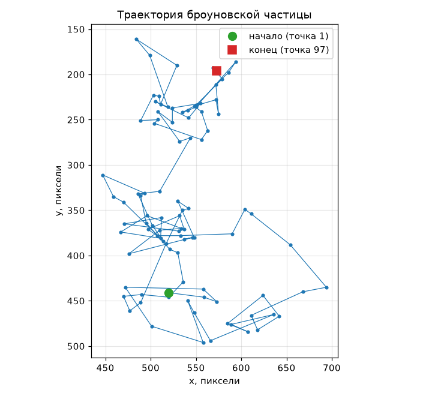
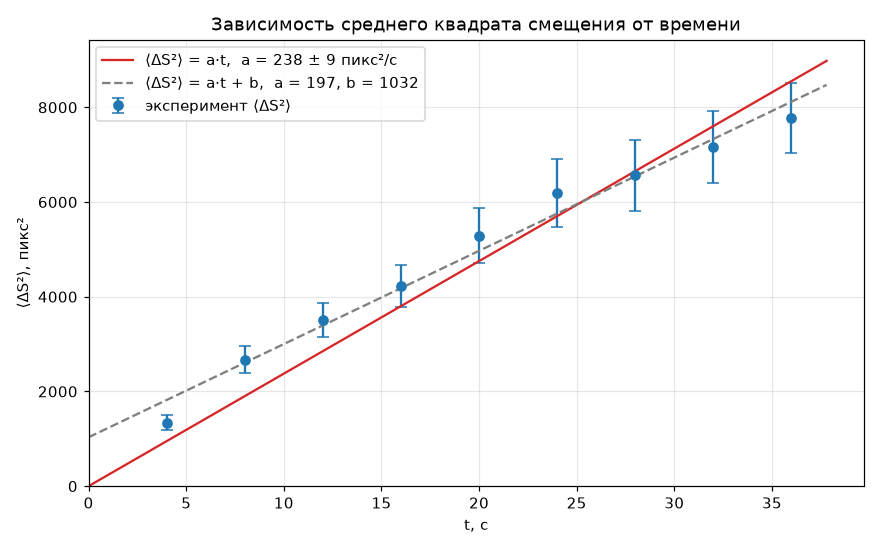
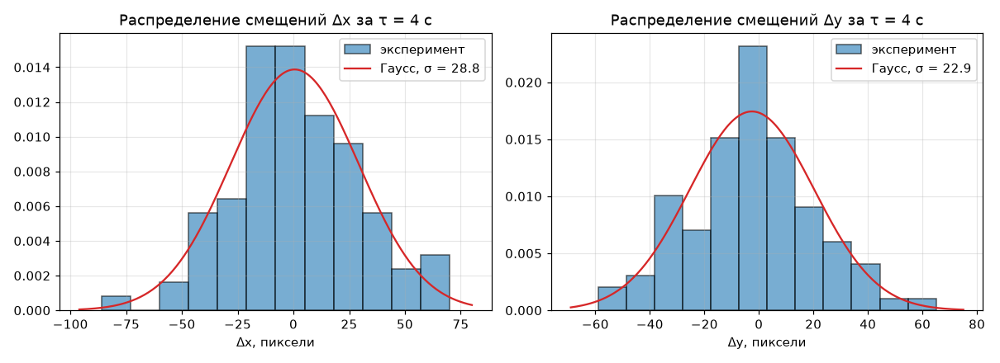

# Лабораторная работа №2. Изучение броуновского движения

## Цель работы

Изучить броуновское движение и проверить на опыте формулу Эйнштейна для среднего квадрата смещения броуновской частицы.

**Оборудование:** микроскоп, цифровая камера которая стоит в тринокуляре микроскопа, компьютер с программой AMCap, эмульсия из молока с низкой жирностью подкрашенная йодом.

---

## Что такое броуновское движение

Если посмотреть в микроскоп на каплю разбавленного молока, видно что маленькие капельки жира всё время дёргаются и блуждают туда-сюда, хотя их никто не трогает. Это и есть броуновское движение.

Причина в том, что жидкость состоит из молекул, а они всё время хаотично двигаются и бьют по частице со всех сторон. Если частица большая, ударов очень много и они друг друга уравновешивают, поэтому большое тело стоит на месте. А если частица маленькая, меньше микрометра, то ударов за короткое время не так много, и с одной стороны случайно прилетает больше чем с другой. Частицу толкает в одну сторону, через мгновение в другую, и получается хаотичная «пляска».

Сами молекулы в микроскоп не видно, а движение частиц видно. Поэтому броуновское движение это одно из самых наглядных доказательств что вещество состоит из движущихся молекул. У нас броуновские частицы это капельки жира размером 0,2–1 мкм.

---

## Теория

### Какие силы действуют на частицу

По второму закону Ньютона `m·dv/dt = F`. Силу от молекул удобно разделить на две части:

1. **Случайная сила Fc.** Пока частица стоит, удары со всех сторон в среднем одинаковые, поэтому в среднем эта сила равна нулю. Но в каждый момент она есть и направлена куда попало.
2. **Сила вязкого трения.** Когда частица движется, то спереди в неё врезается больше молекул чем сзади. Получается сила против движения, пропорциональная скорости: `−v/b`, где b это подвижность частицы.

Обе силы создаются одними и теми же ударами молекул, просто одна часть случайная, а другая зависит от того как частица движется.

Для шарика радиуса a в жидкости с вязкостью η подвижность нашёл Стокс:

```
b = 1 / (6π·η·a)
```

Чем больше шарик, тем меньше подвижность, то есть тем сильнее его тормозит жидкость.

Получается уравнение движения:

```
m·dv/dt = Fc − v/b
```

Кстати это то же самое уравнение что было в первой лабе в задании про движение с трением, только там была сила t², а тут случайная.

### Формула Эйнштейна

Предсказать куда пойдёт одна частица невозможно, сила же случайная. Но можно найти что будет в среднем. Эйнштейн сделал так: умножил уравнение на x и усреднил по множеству частиц. Тут используются два факта:

- среднее от x·Fc равно нулю, потому что толчок никак не связан с тем где сейчас частица;
- частица находится в тепловом равновесии с жидкостью, поэтому её средняя кинетическая энергия по одной оси равна kT/2, как у молекул. Это теорема о равнораспределении энергии.

После решения получается:

```
⟨x²⟩ = 2bkT · [ t − mb·(1 − e^(−t/mb)) ]
```

Здесь mb это время, за которое трение «съедает» скорость частицы и она забывает куда летела. Для частицы размером около микрометра это примерно 10⁻⁷ с, а мы снимаем кадры раз в 4 секунды. Так что t намного больше mb, экспонента пропадает и остаётся

```
⟨x²⟩ = 2bkT·t
```

Мы видим движение в плоскости, по x и по y, и они независимы. Квадрат смещения в плоскости ΔS² = Δx² + Δy², поэтому

```
⟨ΔS²⟩ = 4D·t,      D = bkT = kT / (6π·η·a)
```

D называется коэффициентом диффузии. Это и есть **формула Эйнштейна**.

Главное что тут надо понять: средний квадрат смещения растёт пропорционально **времени**, а не квадрату времени. Если бы частица летела равномерно, то смещение было бы пропорционально t, а его квадрат t². А тут частица всё время меняет направление и много раз возвращается, поэтому за время t она в среднем уходит только на расстояние порядка √t. Это как человек который каждую секунду делает шаг в случайную сторону — он далеко не уйдёт.

Ещё из формулы видно что D больше при большой температуре, ведь молекулы бьют сильнее, и меньше для крупных частиц и для вязкой жидкости.

**Что проверяем:** если формула верна, то график ⟨ΔS²⟩ от t должен быть прямой линией через ноль, а наклон этой прямой равен 4D.

---

## Как проводили опыт

Каплю эмульсии кладут между предметным и покровным стеклом. По краю покровного стекла наносят масло, чтобы эмульсия не испарялась. Если она испаряется, в капле появляются потоки и все частицы уплывают в одну сторону, а нам нужно чистое хаотичное движение. Смотрим через объектив 40х, картинка с камеры выводится на компьютер.

Выбрали одну частицу и каждые τ = 4 с записывали её координаты x и y на экране в пикселях. Получилось **97 точек**, то есть наблюдали 384 секунды. Все данные в файле `tablitsa_pyltsa.xls`.

### Как считали ⟨ΔS²⟩

Чтобы получить ⟨ΔS²⟩ для разных t, не нужно снимать новые серии. Можно брать пары точек на разном расстоянии друг от друга:

- для t = τ = 4 с берём соседние точки: 1–2, 2–3, 3–4 и так до 96–97;
- для t = 2τ = 8 с берём через одну: 1–3, 2–4 и т.д.;
- для t = kτ берём точки i и i+k, таких пар получается n − k.

Для каждой пары считаем квадрат смещения

```
ΔS² = (x_{i+k} − x_i)² + (y_{i+k} − y_i)²
```

и усредняем:

```
⟨ΔS²⟩ = Σ ΔS² / (n − k)
```

Так из одной записи получили сразу 9 точек для графика: t = 4, 8, …, 36 с. Все ΔS² посчитаны в файле `Результаты_ЛР2.xlsx` формулами Excel, а графики строит программа `lab2.py`.

---

## Результаты

### Траектория частицы



*Рисунок 1 — траектория броуновской частицы*

Траектория получилась совсем запутанная, частица то уходит, то возвращается назад, никакого выделенного направления нет. Важно что отрезки между точками это не настоящий путь. Между двумя кадрами частица успевает сделать огромное число мелких зигзагов, которые мы просто не видим. Если снимать чаще, каждый отрезок сам превратится в такую же ломаную.

### Средний квадрат смещения

| k | t, с | число пар | Σ ΔS², пикс² | ⟨ΔS²⟩, пикс² | ошибка, пикс² |
|---|---|---|---|---|---|
| 1 | 4 | 96 | 128 956 | 1 343 | ±155 |
| 2 | 8 | 95 | 253 777 | 2 671 | ±283 |
| 3 | 12 | 94 | 329 753 | 3 508 | ±356 |
| 4 | 16 | 93 | 393 410 | 4 230 | ±441 |
| 5 | 20 | 92 | 486 168 | 5 284 | ±583 |
| 6 | 24 | 91 | 563 616 | 6 194 | ±714 |
| 7 | 28 | 90 | 590 490 | 6 561 | ±749 |
| 8 | 32 | 89 | 636 615 | 7 153 | ±759 |
| 9 | 36 | 88 | 684 298 | 7 776 | ±740 |

Ошибка в последнем столбце это стандартная ошибка среднего: разброс ΔS² делённый на корень из числа пар.

Видно что ⟨ΔS²⟩ растёт вместе с t: за 36 с примерно в 6 раз больше чем за 4 с.

### Проверка формулы Эйнштейна



*Рисунок 2 — зависимость ⟨ΔS²⟩ от t*

Через точки провели прямую методом наименьших квадратов. Красная прямая проходит через ноль, как требует формула Эйнштейна. Её наклон:

```
a = 238 ± 9 пикс²/с
```

Значит коэффициент диффузии

```
D = a / 4 = 59,4 ± 2,2 пикс²/с
```

Коэффициент корреляции **r = 0,991**, то есть точки очень хорошо ложатся на прямую. Почти все точки попадают на неё в пределах своих ошибок.

Серая пунктирная прямая это прямая общего вида a·t + b, её так строит Linear Fit в Origin. У неё a = 197 пикс²/с и D = 49,2 пикс²/с. Она не проходит через ноль, про это ниже в погрешностях.

Чтобы перевести D в м²/с, надо знать сколько микрометров приходится на один пиксель при объективе 40х. Тогда D в мкм²/с = D в пикс²/с умножить на квадрат масштаба. А зная D, по формуле D = kT/(6πηa) можно даже найти размер частицы.

### Распределение смещений



*Рисунок 3 — распределение смещений частицы по x и по y за 4 с*

Ещё проверили что толчки правда случайные. На гистограммах смещения за один шаг 4 с. За это время частица получает огромное число независимых ударов, а сумма многих случайных величин распределена по Гауссу. Так и получилось: гистограммы похожи на колокол и симметричны относительно нуля. Средние смещения за шаг ⟨Δx⟩ = 0,55 пикс и ⟨Δy⟩ = −2,55 пикс намного меньше разброса σx = 28,8 пикс и σy = 22,9 пикс. То есть частица никуда не уносится течением, а блуждает случайно.

---

## Погрешности

Откуда могут быть отклонения от прямой:

1. **Мало данных.** Следили всего за одной частицей, 97 точек. Для больших t пары точек перекрываются и сильно зависят друг от друга: независимых отрезков по 36 с за 384 с всего около десяти. Поэтому последние точки на графике самые неточные, и они немного ниже прямой.
2. **Неточно отмечаем положение частицы.** Частица на экране это размытое пятнышко, она ещё и уходит из фокуса, поэтому координаты определяются с ошибкой в несколько пикселей. Эта ошибка добавляет ко всем ⟨ΔS²⟩ примерно одинаковую добавку. Из-за этого прямая общего вида не проходит через ноль, у неё b ≈ 1030 пикс².
3. **Небольшой дрейф.** В среднем частица за шаг смещалась на 2,55 пикс по y, возможно в капле было слабое течение. Но его вклад при t = 36 с всего около 530 пикс², это меньше 10% от ⟨ΔS²⟩, так что на результат это сильно не влияет.
4. **⟨Δx²⟩ и ⟨Δy²⟩ немного разные:** 819 и 524 пикс² за один шаг. По теории они должны быть одинаковые, ведь движение во все стороны равновероятно. При 96 значениях случайная ошибка каждого около 15%, так что разница отчасти случайная, а отчасти может быть из-за того же течения.

Чтобы было точнее, надо проследить несколько частиц и усреднить. В таблице для этого есть листы «Частица 2» и «Частица 3», но они пустые.

---

## Вывод

1. Построили траекторию броуновской частицы по 97 точкам через 4 с. Движение хаотичное, смещения за шаг распределены примерно по Гауссу и в среднем около нуля. Это значит что частицу толкают случайные удары молекул.
2. Посчитали средний квадрат смещения для t от 4 до 36 с. Он растёт от 1343 до 7776 пикс², и зависимость от t линейная, r = 0,991.
3. По наклону прямой нашли коэффициент диффузии **D = 59,4 ± 2,2 пикс²/с**.
4. **Формула Эйнштейна ⟨ΔS²⟩ = 4D·t подтверждается:** средний квадрат смещения растёт пропорционально времени, а не квадрату времени, как было бы при обычном движении. Отклонения отдельных точек связаны с тем что данных мало и координаты отмечены неточно.

---

## Ответы на контрольные вопросы

**1. Что называется броуновским движением?**

Это беспорядочное непрерывное движение маленьких частиц в жидкости или газе. Оно происходит из-за того что молекулы среды всё время хаотично двигаются и бьют по частице, и эти удары с разных сторон не уравновешивают друг друга.

**2. Какие частицы можно назвать броуновскими?**

Частицы которые достаточно маленькие, примерно от 0,1 до нескольких микрометров. Они такие маленькие что удары молекул по ним не успевают уравновеситься и частица заметно дёргается. Но при этом они намного больше молекул, поэтому их видно в микроскоп. У нас это капельки жира 0,2–1 мкм.

**3. Почему силу действия молекул на броуновскую частицу можно разделить на случайную силу и силу вязкого трения?**

Когда частица стоит, удары со всех сторон в среднем одинаковые, и остаётся только случайная сила, у которой среднее ноль. Когда частица движется, спереди в неё врезается больше молекул и сильнее чем сзади. Это даёт дополнительную силу против движения, которая в среднем пропорциональна скорости — это и есть вязкое трение. То есть обе силы от одних и тех же ударов молекул, просто одна часть случайная, а другая зависит от скорости частицы.

**4. Зависит ли сила вязкого трения шарообразной броуновской частицы от её диаметра?**

Да, зависит. По формуле Стокса F = 6π·η·a·v, то есть сила трения прямо пропорциональна радиусу шарика. Чем больше шарик, тем больше жидкости ему приходится расталкивать когда он движется. Поэтому у крупных частиц подвижность и коэффициент диффузии меньше и они блуждают медленнее, а совсем крупные тела вообще не видно чтобы дёргались.

---

## Код программы

Файл `lab2.py`:

```python
"""Лабораторная работа 2. Изучение броуновского движения.

Проверка формулы Эйнштейна <ΔS²> = 4·D·t по координатам одной частицы,
снятым через равные промежутки времени τ.
"""
import os

import matplotlib
matplotlib.use("Agg")
import matplotlib.pyplot as plt
import numpy as np
import xlrd
from openpyxl import Workbook
from openpyxl.styles import Alignment, Font
from openpyxl.utils import get_column_letter

HERE = os.path.dirname(os.path.abspath(__file__))
SRC = os.path.join(HERE, "ЛР 2", "tablitsa_pyltsa.xls")
OUT = os.path.join(HERE, "plots")
XLSX = os.path.join(HERE, "Результаты_ЛР2.xlsx")
os.makedirs(OUT, exist_ok=True)

TAU = 4.0          # шаг по времени между кадрами, с (из шапки таблицы: dt = 4 s)
K_MAX = 9          # t = τ, 2τ, …, 9τ (столбцы таблицы)
# Масштаб изображения, мкм на пиксель. Если преподаватель даст значение,
# впишите его сюда — программа пересчитает D в мкм²/с и м²/с.
SCALE_UM_PER_PX = None

plt.rcParams.update({"figure.dpi": 110, "axes.grid": True, "grid.alpha": 0.3})


def save(fig, name):
    fig.tight_layout()
    fig.savefig(os.path.join(OUT, name))
    plt.close(fig)


def load_coords(path):
    """Читает координаты x, y (пиксели) с первого листа, пока они заполнены."""
    sh = xlrd.open_workbook(path).sheet_by_index(0)
    pts = []
    for r in range(2, sh.nrows):
        x, y = sh.cell_value(r, 1), sh.cell_value(r, 2)
        if x == "" or y == "":
            break
        pts.append((float(x), float(y)))
    return np.array(pts)


def msd(xy, k_max):
    """Для каждого k: все квадраты смещений (ΔS)² между точками i и i+k (как в Таблице 1)."""
    sq = []
    for k in range(1, k_max + 1):
        d = xy[k:] - xy[:-k]
        sq.append((d**2).sum(axis=1))
    return sq


def fit_through_zero(t, s2):
    """МНК для прямой <ΔS²> = a·t (через начало координат, как в формуле Эйнштейна)."""
    a = (t * s2).sum() / (t * t).sum()
    resid = s2 - a * t
    da = np.sqrt((resid**2).sum() / (len(t) - 1) / (t * t).sum())
    return a, da


def plot_trajectory(xy):
    fig, ax = plt.subplots(figsize=(6.5, 6))
    ax.plot(xy[:, 0], xy[:, 1], "-o", ms=3, lw=0.8, color="tab:blue")
    ax.plot(*xy[0], "o", ms=9, color="tab:green", label="начало (точка 1)")
    ax.plot(*xy[-1], "s", ms=9, color="tab:red", label=f"конец (точка {len(xy)})")
    ax.set(title="Траектория броуновской частицы", xlabel="x, пиксели", ylabel="y, пиксели", aspect="equal")
    ax.invert_yaxis()  # у изображения ось y направлена вниз
    ax.legend()
    save(fig, "trajectory.png")


def plot_msd(t, s2, err, a, da, a2, b2):
    tt = np.linspace(0, t.max() * 1.05, 100)
    fig, ax = plt.subplots(figsize=(8, 5))
    ax.errorbar(t, s2, yerr=err, fmt="o", capsize=4, color="tab:blue", label="эксперимент ⟨ΔS²⟩")
    ax.plot(tt, a * tt, color="tab:red", label=f"⟨ΔS²⟩ = a·t,  a = {a:.0f} ± {da:.0f} пикс²/с")
    ax.plot(tt, a2 * tt + b2, "--", color="tab:gray", label=f"⟨ΔS²⟩ = a·t + b,  a = {a2:.0f}, b = {b2:.0f}")
    ax.set(title="Зависимость среднего квадрата смещения от времени",
           xlabel="t, с", ylabel="⟨ΔS²⟩, пикс²", xlim=(0, None), ylim=(0, None))
    ax.legend()
    save(fig, "msd.png")


def plot_steps(xy):
    d = np.diff(xy, axis=0)
    fig, ax = plt.subplots(1, 2, figsize=(11, 4))
    for i, name in enumerate(("Δx", "Δy")):
        v = d[:, i]
        sig = v.std(ddof=1)
        ax[i].hist(v, bins=12, density=True, alpha=0.6, color="tab:blue", edgecolor="k", label="эксперимент")
        g = np.linspace(v.min() - 10, v.max() + 10, 200)
        ax[i].plot(g, np.exp(-(g - v.mean())**2 / (2 * sig**2)) / (sig * np.sqrt(2 * np.pi)),
                   color="tab:red", label=f"Гаусс, σ = {sig:.1f}")
        ax[i].set(title=f"Распределение смещений {name} за τ = {TAU:.0f} с", xlabel=f"{name}, пиксели")
        ax[i].legend()
    save(fig, "steps_hist.png")


def write_xlsx(xy, sq, t, s2, a, da, D):
    """Заполненная таблица в виде Таблицы 1 из методички + лист с итогами."""
    wb = Workbook()
    ws = wb.active
    ws.title = "Частица 1"
    bold = Font(bold=True)
    c = Alignment(horizontal="center", vertical="center", wrap_text=True)
    ws["A1"], ws["B1"], ws["D1"] = "№", "Координаты частицы", f"(ΔS)², пикс²   (τ = {TAU:.0f} с)"
    ws.merge_cells("B1:C1")
    ws.merge_cells(start_row=1, start_column=4, end_row=1, end_column=3 + K_MAX)
    ws["B2"], ws["C2"] = "x, пикс", "y, пикс"
    for k in range(1, K_MAX + 1):
        ws.cell(2, 3 + k, f"пара i–(i+{k})\nt = {k}τ = {k * TAU:.0f} с")
    n = len(xy)
    first, last = 3, 2 + n
    for i in range(n):
        r = first + i
        ws.cell(r, 1, i + 1)
        ws.cell(r, 2, xy[i, 0])
        ws.cell(r, 3, xy[i, 1])
        for k in range(1, K_MAX + 1):
            if i + k < n:
                # формула, чтобы в Excel было видно, как считается каждое число
                ws.cell(r, 3 + k, f"=(B{r + k}-B{r})^2+(C{r + k}-C{r})^2")
    r = last + 2
    labels = ("Σ(ΔS)²", "число пар n−k", "⟨ΔS²⟩ = Σ/(n−k)", "t, с")
    for j, lab in enumerate(labels):
        ws.cell(r + j, 1, lab).font = bold
        ws.merge_cells(start_row=r + j, start_column=1, end_row=r + j, end_column=3)
    for k in range(1, K_MAX + 1):
        col = get_column_letter(3 + k)
        ws.cell(r, 3 + k, f"=SUM({col}{first}:{col}{last - k})")
        ws.cell(r + 1, 3 + k, n - k)
        ws.cell(r + 2, 3 + k, f"={col}{r}/{col}{r + 1}").number_format = "0.0"
        ws.cell(r + 3, 3 + k, k * TAU)
    for row in ws.iter_rows(min_row=1, max_row=2):
        for cell in row:
            cell.font, cell.alignment = bold, c
    ws.row_dimensions[2].height = 32
    ws.column_dimensions["A"].width = 8
    for k in range(2, 4 + K_MAX):
        ws.column_dimensions[get_column_letter(k)].width = 13

    ws2 = wb.create_sheet("Итог")
    ws2.append(["t, с", "⟨ΔS²⟩, пикс²", "число пар", "a·t (прямая), пикс²"])
    for k in range(K_MAX):
        ws2.append([float(t[k]), round(float(s2[k]), 1), len(sq[k]), round(float(a * t[k]), 1)])
    ws2.append([])
    ws2.append(["Наклон a, пикс²/с", round(a, 1), "±", round(da, 1)])
    ws2.append(["D = a/4, пикс²/с", round(D, 1), "±", round(da / 4, 1)])
    for cell in ws2[1]:
        cell.font = bold
    for col in "ABCD":
        ws2.column_dimensions[col].width = 22
    wb.save(XLSX)


def main():
    xy = load_coords(SRC)
    n = len(xy)
    sq = msd(xy, K_MAX)
    k = np.arange(1, K_MAX + 1)
    t = k * TAU
    s2 = np.array([v.mean() for v in sq])
    err = np.array([v.std(ddof=1) / np.sqrt(len(v)) for v in sq])

    a, da = fit_through_zero(t, s2)
    a2, b2 = np.polyfit(t, s2, 1)
    r = np.corrcoef(t, s2)[0, 1]
    D, dD = a / 4, da / 4

    plot_trajectory(xy)
    plot_msd(t, s2, err, a, da, a2, b2)
    plot_steps(xy)
    write_xlsx(xy, sq, t, s2, a, da, D)

    print(f"Точек: n = {n}, τ = {TAU} с, полное время наблюдения {(n - 1) * TAU:.0f} с")
    print(" k   t,с  пар   <ΔS²>,пикс²   ±σ")
    for i in range(K_MAX):
        print(f"{k[i]:2d}  {t[i]:4.0f}  {len(sq[i]):3d}  {s2[i]:10.1f}  {err[i]:7.1f}")
    print(f"Прямая через 0:  a = {a:.1f} ± {da:.1f} пикс²/с  ->  D = a/4 = {D:.1f} ± {dD:.1f} пикс²/с")
    print(f"Прямая a·t+b:    a = {a2:.1f} пикс²/с, b = {b2:.0f} пикс²  ->  D = {a2 / 4:.1f} пикс²/с")
    print(f"Коэффициент корреляции r = {r:.4f}")
    d1 = np.diff(xy, axis=0)
    print(f"<Δx²>(τ) = {(d1[:, 0]**2).mean():.0f}, <Δy²>(τ) = {(d1[:, 1]**2).mean():.0f} пикс²")
    print(f"Средний шаг: <Δx> = {d1[:, 0].mean():.2f}, <Δy> = {d1[:, 1].mean():.2f} пикс")
    if SCALE_UM_PER_PX:
        Dum = D * SCALE_UM_PER_PX**2
        print(f"D = {Dum:.3f} мкм²/с = {Dum * 1e-12:.2e} м²/с")
        kT, eta = 1.380649e-23 * 293, 1.0e-3
        print(f"Радиус частицы по Стоксу–Эйнштейну a = kT/(6πηD) = {kT / (6 * np.pi * eta * Dum * 1e-12) * 1e6:.2f} мкм")


if __name__ == "__main__":
    main()
```
